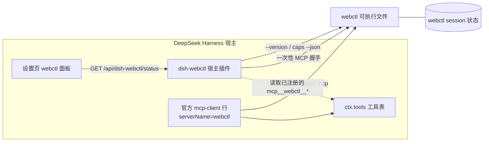

# dsh-webctl

**把 [webctl](https://github.com/Thatgfsj/webctl) 的全部 18 个工具接进 DeepSeek Harness（DSH），并在插件设置页诊断 webctl 与 Playwright 状态。**

> Playwright 在这里只有一个身份：**当 webctl 明确报告“无法识别 / JS 渲染页”时的可选回退**。
> webctl 本身不依赖浏览器、不执行外部进程；本插件也不会因为 Playwright 缺失而让 webctl 的工具消失。

## 它做什么

| 能力 | 说明 |
| --- | --- |
| 全量工具接入 | 通过官方 `@deepseek-ai/dsh-mcp-client` 行启动 `webctl mcp`，把 18 个工具注册成 `mcp__webctl__*`：`fetch` / `extract` / `search` / `links` / `tables` / `forms` / `fill_form` / `paginate` / `session` / `cookies` / `json_query` / `doc_text` / `embedded_data` / `download` / `robots` / `resolve_site` / `caps` / `web_search` |
| webctl 诊断 | 可执行文件解析、`--version`、`caps --json`、真实 MCP 握手（initialize + tools/list），以及 **DSH 里实际注册到的工具清单** |
| Playwright 诊断 | 包是否安装（名称/版本/路径）、浏览器缓存目录与已安装条目、`WEBCTL_FALLBACK_TOOL` 声明、可选的一次性启动冒烟 |
| 设置页面板 | DSH「设置 → webctl」中展示以上状态、诊断与刷新按钮，无需看日志猜“为什么工具没出现” |

## 架构



- 工具由**官方 MCP 客户端**注册，本插件不重新实现 MCP 协议、不改写工具结果。
- 宿主插件只用 Node 内置模块，不 import 任何 `@deepseek-ai/*` 包，因此没有依赖解析失败导致的“静默不加载”。
- 状态接口只读；探测全部有超时与输出上限。

## 安装

要求：DSH `0.2.x`（实测 `0.2.2-rc.1`）；本机已安装 webctl（推荐 `0.2.2` 及以上，0.2.3 已合入上游主干的降级字段会逐步适配）。

```bash
# 从本地目录（开发时推荐）
dsh plugin --profile web add /absolute/path/to/dsh-webctl

# 从 tarball
pnpm pack
dsh plugin --profile web add /absolute/path/to/dsh-webctl-0.1.0.tgz
```

安装后**重启** `dsh web`。

校验两行都已进入组合配置：

```bash
dsh --profile web --dump-config | grep -A8 "id: mcp-client-webctl"
```

## 配置

本 bundle 插入两行，都可以在 **profile 的 `cordis.patch.yml`** 里按 id 覆盖（**覆盖会整体替换 config，必须重述每个键**）：

```yaml
# 1) 诊断插件：让它探测与 mcp-client 行相同的可执行文件
- id: dsh-webctl
  config:
    command: /home/me/.local/bin/webctl
    args: [mcp]
    timeoutMs: 8000
    serverName: webctl
    playwright:
      searchDirs: [/home/me/work/my-app]
      launchSmoke: false

# 2) 工具行：把命令换成绝对路径（不依赖 PATH）
- id: mcp-client-webctl
  config:
    transport: stdio
    serverName: webctl
    command: /home/me/.local/bin/webctl
    args: [mcp]
    toolCallTimeoutMs: 60000
    failOnStartupError: false
```

> 两行的 `command` 建议保持一致：诊断页会用 `dsh-webctl` 的 `command` 探测版本与 MCP 握手，
> 而工具实际由 `mcp-client-webctl` 行启动。设置页同时显示**宿主实际注册到的工具清单**，
> 二者不一致时一眼就能看出来。

### 声明 Playwright 回退能力（可选）

webctl 0.2.3 起支持 `WEBCTL_FALLBACK_TOOL=<名字>:<工具名>`：声明后，只有 `fallback_hint.playwright_suitable=true` 的降级信封才会在 `next_steps` 里指向该工具。webctl **只给建议，绝不主动调用**。

两件事要分清：

1. **预览与校验**：在 `dsh-webctl` 行设置 `fallbackTool`，插件会用它去跑一次 `webctl caps --json`，在状态页显示是否被 webctl 识别（`FALLBACK_TOOL_ACTIVE` / `FALLBACK_TOOL_NOT_REPORTED` / `FALLBACK_TOOL_INVALID`）。
2. **真正生效**：必须写进 `mcp-client-webctl` 行的 `env`（或宿主进程环境），因为工具调用跑在那个子进程里。

```yaml
- id: mcp-client-webctl
  config:
    transport: stdio
    serverName: webctl
    command: /home/me/.local/bin/webctl
    args: [mcp]
    toolCallTimeoutMs: 60000
    failOnStartupError: false
    env:
      WEBCTL_FALLBACK_TOOL: playwright:playwright_browser_snapshot

# 3) 诊断行（可选）：让状态页校验声明是否被 webctl 识别
- id: dsh-webctl
  config:
    command: /home/me/.local/bin/webctl
    fallbackTool: playwright:playwright_browser_snapshot
```

## 状态接口

`GET /api/dsh-webctl/status`（同源会话鉴权，与 DSH 其它 `/api` 路由一致），`?refresh=1` 跳过 5 秒缓存：

```json
{
  "ok": true,
  "checkedAt": "2026-11-10T04:27:25.149Z",
  "webctl": { "state": "ready", "version": "0.2.2", "resolvedPath": "/usr/local/bin/webctl", "toolCount": 18 },
  "webctlMcp": { "state": "ready", "toolCount": 18, "registeredTools": ["mcp__webctl__fetch", "…"] },
  "playwright": { "state": "partial", "package": { "found": true }, "browsers": { "exists": false } },
  "diagnostics": [ { "level": "ok", "code": "MCP_REGISTERED", "message": "宿主已注册 18 个 mcp__ 工具。" } ]
}
```

## 常见诊断码

| code | 含义与处理 |
| --- | --- |
| `WEBCTL_MISSING` | 找不到 webctl 可执行文件；安装它，或在两行补丁里写绝对路径 |
| `WEBCTL_VERSION_FAILED` / `WEBCTL_CAPS_FAILED` | 二进制存在但 `--version` / `caps --json` 失败；手工跑一次确认 |
| `MCP_READY` / `MCP_REGISTERED` | 握手成功 / 宿主已注册的 `mcp__webctl__*` 工具数 |
| `MCP_NOT_REGISTERED` | 工具行没连上；看 DSH 日志里的 `mcp-client(webctl)` |
| `MCP_TOOL_DRIFT` | `caps` 与 `tools/list` 工具集合不同（版本不一致或上游变更） |
| `MCP_REGISTRATION_MISMATCH` | 探测用的 webctl 与工具行启动的可能不是同一个二进制；把两行 `command` 对齐 |
| `FALLBACK_TOOL_ACTIVE` / `_NOT_REPORTED` / `_INVALID` | 回退声明被识别 / 未被报告（版本过旧）/ 格式错误 |
| `PLAYWRIGHT_MISSING` | 可选回退通道未安装；不影响 webctl |
| `PLAYWRIGHT_FALLBACK_UNAVAILABLE` | 最近降级建议 Playwright，但本机未就绪；先试 `embedded_data` |

## Playwright 的边界

- 默认**只读**：读 `node_modules/playwright*/package.json` 与浏览器缓存目录，**不执行任何用户代码、不下载浏览器、不启动浏览器、不访问站点**。
- 可选的一次性启动冒烟（`launchSmoke: true`）会启动 headless Chromium 并立即关闭，用来验证“包装了但浏览器坏了”这类情况；失败只影响诊断，不影响 webctl。
- 登录态接力（webctl session → Playwright `storage_state`）属于后续里程碑，默认不导出、不注入。

## 安全

完整威胁模型与默认姿态见 [docs/SECURITY.md](docs/SECURITY.md)。

- 只用 `spawn(argv)`、`shell: false`；路径来自配置，不从网页内容拼接。
- 探测输出有字节上限与超时；诊断里不包含页面内容、cookie 或凭据。
- 工具结果按 webctl 的信封原样交给模型，网页内容仍是不可信输入（`trust: untrusted_page_content`）。
- `fill_form`、`cookies` 等有副作用/敏感操作遵循 webctl 自身的确认与脱敏语义。

## 开发

```bash
node --test tests/*.test.mjs       # 离线单测（假 webctl / 假 MCP 服务）
node scripts/build-client.mjs      # 重新生成 client.js
node scripts/build-client.mjs --check
node --check client.js             # 客户端语法

# 真实二进制测试（不设 WEBCTL_BIN 则自动跳过）
WEBCTL_BIN=/path/to/webctl node --test tests/contract.test.mjs
# 断言：caps 与 tools/list 工具面一致、版本一致、两个 MCP 探测可并发成功
WEBCTL_BIN=/path/to/webctl node --test tests/tools-real.test.mjs
# 真实调用 9 个离线工具（extract/search/links/tables/forms/embedded_data/json_query/caps/doc_text），
# 断言插件能解析真实信封、trust 标记与内联 HTML 不触发降级的上游语义
```

真机冒烟（**不碰真实 `~/.dsh`**：临时 DSH_HOME + web 测试 profile + 随机端口，跑完删除）：

```bash
node scripts/e2e-smoke.mjs --webctl /path/to/webctl
# 断言：插件安装成功、MCP 连通、18 个 mcp__webctl__* 已注册、
#       状态接口字段齐全、client bundle 可下载且含 settings.section
```

故障矩阵（同样隔离）：

```bash
node scripts/e2e-faults.mjs --webctl /path/to/webctl
# A: webctl 不存在 -> WEBCTL_MISSING + 0 个已注册工具，状态页仍 200
# B: 禁用 mcp-client-webctl -> webctl ready + 0 已注册工具 + MCP_NOT_REGISTERED
```

退出码：0 通过；1 失败；2 跳过（缺少 `dsh` 或 `webctl`）。加 `--keep` 保留临时目录便于排查（仅 `e2e-smoke` 支持）。

## 版本兼容

| 组件 | 支持范围 | 说明 |
| --- | --- | --- |
| DSH | `>=0.2.1-rc.2 <0.3.0-0` | 实测 `0.2.2-rc.1` |
| webctl | `0.2.2`（18 工具）起 | 0.1.x 只有 15 个工具，状态页会显示实际数量 |
| Playwright | 任意 | 仅诊断，不参与 webctl 运行 |

## 发布

版本、检查单、tag 与回滚流程见 [docs/RELEASE.md](docs/RELEASE.md)。

## 验收

自动化覆盖与需要人工验证的检查单见 [docs/ACCEPTANCE.md](docs/ACCEPTANCE.md)。

## 路线图

里程碑与拆分见 [Issues](https://github.com/thatgfsj-dsh/dsh-webctl/issues) 与总议题 [#1](https://github.com/thatgfsj-dsh/dsh-webctl/issues/1)。

## License

MIT