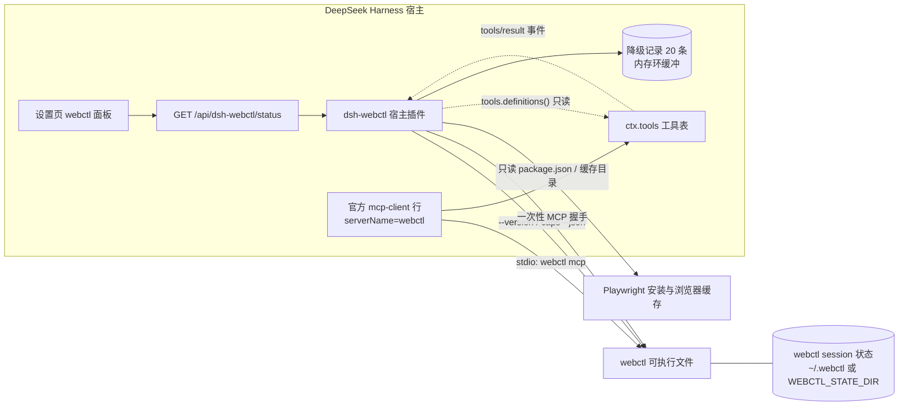
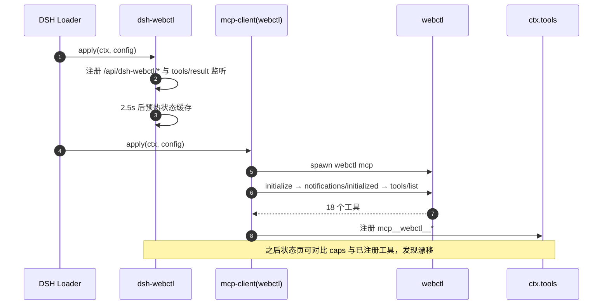
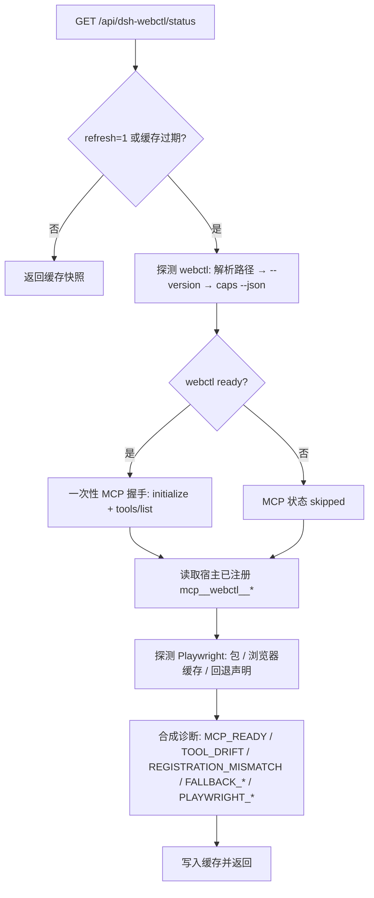
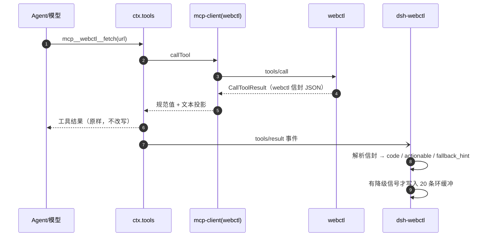
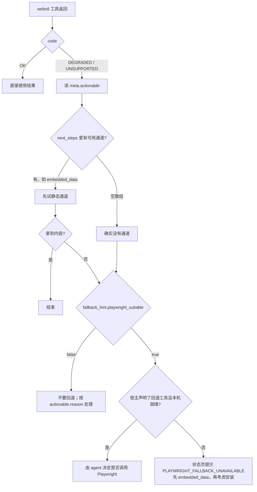
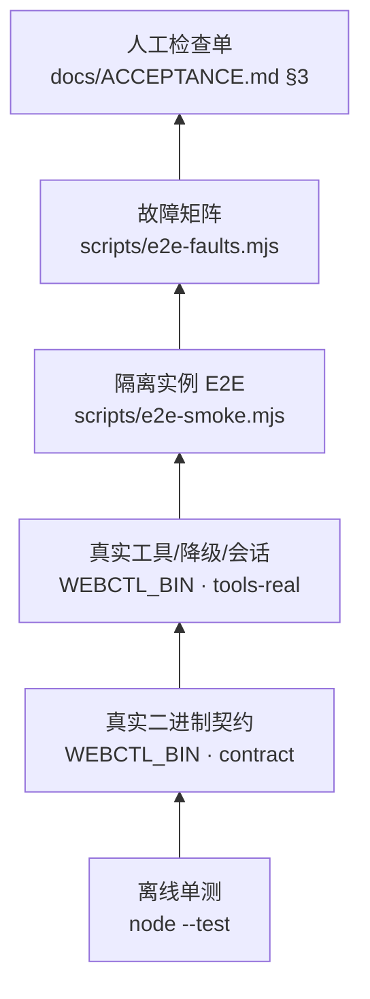

# 架构与流程图

本文用 Mermaid 描述 dsh-webctl 的结构、启动时序、状态采集、工具调用与降级回退决策。
图与代码的实际关系：**工具注册与调用走官方 MCP 客户端；本插件只做诊断、观测与展示。**

## 1. 组件与数据流

- 宿主插件只用 Node 内置模块，不 import 任何 `@deepseek-ai/*` 包，避免依赖解析失败导致的静默不加载。
- 工具名固定为 `mcp__webctl__<rawName>`，由官方桥接层生成；插件不硬编码、也不改写。

## 2. 启动时序

> DSH 可能先起探测进程再起服务进程；webctl 不在启动时抢独占锁，因此两个实例可并发。
> `tests/contract.test.mjs` 用真实二进制验证了这一点。

## 3. 状态采集（按需 + 短缓存）

- 缓存 5 秒、并发请求合并；`?refresh=1` 强制重算。
- 所有子进程 `shell:false`、带超时与输出上限；握手拿到工具清单即关闭。

## 4. 一次工具调用与降级观测

插件**不参与**结果渲染：模型看到的仍是上游信封；插件只旁路记录元数据（不含页面正文与凭据）。

## 5. 降级与 Playwright 回退决策

对应实现：`src/host/degradations.mjs`（解析与记录）、`src/host/status.mjs`（`fallbackReadiness` 与诊断）。

## 6. 验证分层

每一层的命令与覆盖范围见 [ACCEPTANCE.md](ACCEPTANCE.md)；发布前检查见 [RELEASE.md](RELEASE.md)。
